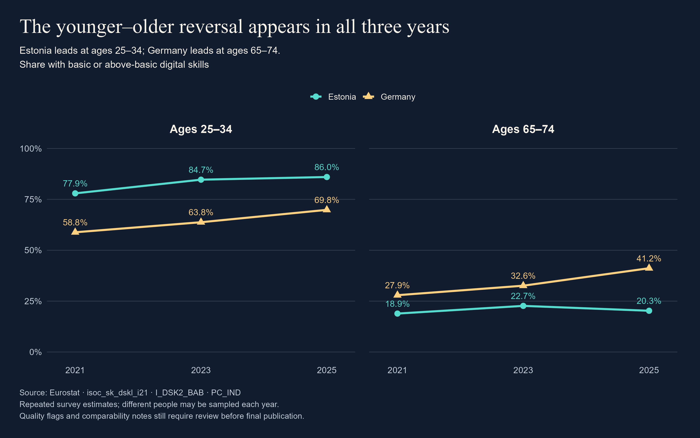
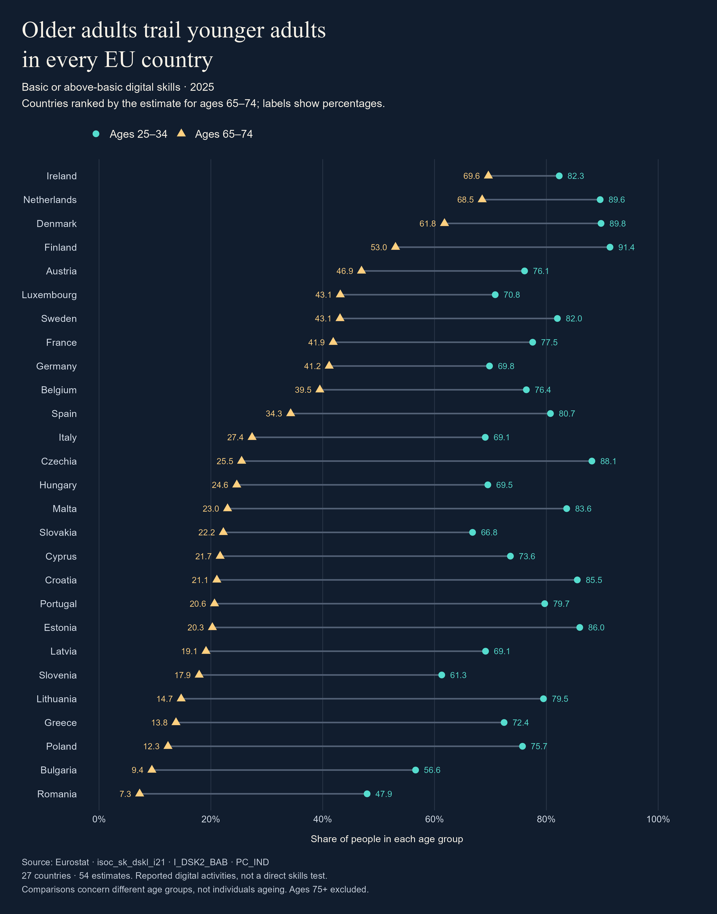
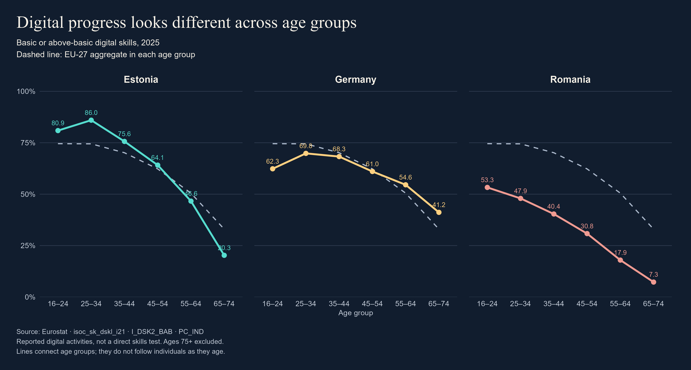

```{r}
#| label: setup
#| include: false
skills <- read.csv("data/digital_skills_age_eu.csv", stringsAsFactors = FALSE)
stopifnot(!anyDuplicated(skills[c("geo", "ind_type", "time")]))
value <- function(country, age, year) {
  z <- skills$values[skills$geo == country & skills$ind_type == age & skills$time == year]
  stopifnot(length(z) == 1L, !is.na(z))
  z
}
pct <- function(z) sprintf("%.1f%%", z)
pp <- function(z) sprintf("%.1f", z)
older <- subset(skills, time == 2025 & geo != "EU27_2020" & ind_type == "Y65_74")
younger <- subset(skills, time == 2025 & geo != "EU27_2020" & ind_type == "Y25_34")
pairs <- merge(older[c("geo", "values")], younger[c("geo", "values")],
               by = "geo", suffixes = c("_older", "_younger"))
stopifnot(nrow(pairs) == 27, !anyNA(pairs))
```

## Same countries. A different answer.

Estonia leads Germany in digital skills among adults aged 25–34. Among those aged 65–74, Germany comes out ahead. **The comparison reverses in all three years we examined: 2021, 2023 and 2025.**

We went into this expecting Estonia to be one of the clear standouts. After reading about its digital reputation, we thought we had a fairly good idea of what we would find. Apparently, the data had other plans.

In 2025, `r pct(value("EE", "Y25_34", 2025))` of adults aged 25–34 in Estonia met Eurostat's threshold for basic or above-basic overall digital skills, compared with `r pct(value("DE", "Y25_34", 2025))` in Germany. Among adults aged 65–74, Germany's estimate was `r pct(value("DE", "Y65_74", 2025))` and Estonia's was `r pct(value("EE", "Y65_74", 2025))`.

Same countries, same year. Looking at a different age group changed the answer. It made us question what we mean when we call a country “digitally advanced”. **Whose experience are we talking about?**

{#fig-reversal width=100% fig-alt="Two panels compare Germany and Estonia over three survey years. Estonia leads for ages 25–34 in every year; Germany leads for ages 65–74."}

We checked the earlier years because we did not want to build our story around a single snapshot. @fig-reversal shows the same ordering in 2021 and 2023. Germany's lead among the older group was `r pp(value("DE", "Y65_74", 2021) - value("EE", "Y65_74", 2021))` percentage points in 2021, `r pp(value("DE", "Y65_74", 2023) - value("EE", "Y65_74", 2023))` in 2023 and `r pp(value("DE", "Y65_74", 2025) - value("EE", "Y65_74", 2025))` in 2025.

Those differences describe the published estimates. We have not tested whether they are statistically significant or established what caused them.

### What counts as digital skills here?

Eurostat builds this measure from activities people report doing across five areas, including communication, safety and problem solving. To meet the overall threshold, someone needs at least basic skills in every area. It is a proxy for skills, rather than a practical test. Falling below the threshold does **not** mean a person has no digital skills. The definition follows Eurostat (n.d.-b).

## We widened the view to Europe

Was there something unusual about our chosen countries? In 2025, the estimate for ages 65–74 was below that for ages 25–34 in `r sum(pairs$values_older < pairs$values_younger)` out of the 27 EU countries.

In @fig-europe, each country has two dots. The line between them shows the gap between the age groups. A longer line means a larger difference in percentage points. It does not trace what happens to one person as they get older.

{#fig-europe width=100% fig-alt="Paired dots compare younger and older adults in each EU country. Every country's estimate is lower for ages 65–74. Ireland has the highest estimate for the older group; Romania the lowest."}

The countries near the top caught our attention too. Ireland, the Netherlands, Denmark and Finland had the highest estimates for the older group. Estonia's position among younger adults did not tell us where it would sit among older adults.

## Being the same age does not mean sharing the same experience

Among adults aged 65–74, the estimates ranged from `r pct(min(older$values))` in Romania to `r pct(max(older$values))` in Ireland. The EU-27 aggregate was `r pct(value("EU27_2020", "Y65_74", 2025))`.

That is a substantial range within one age group. Talking about “older people” as if they all have the same relationship with technology would miss it. It would also miss the differences between individuals within each country, which these group-level figures cannot show.

Looking at all six age groups gives our selected countries more context (@fig-profiles). Germany's estimates sit below the EU benchmark for ages 16–54, then above it for ages 55–74. Estonia shows the reverse pattern. Romania sits below the benchmark in all six groups.

{#fig-profiles width=100% fig-alt="Three panels compare each selected country with the EU aggregate across six age groups. Germany is above the benchmark in the two older groups, Estonia in the four younger groups, and Romania below it in all six."}

Research gives us a reason to take those individual differences seriously. van Deursen and Helsper (2015) found that older adults differ in their internet use and non-use, including differences associated with education, household circumstances and attitudes. A survey of older American adults also found substantial variation in internet skills associated with socioeconomic background and autonomy of use (Hargittai, Piper and Morris, 2019). Having an internet connection does not tell us what someone can comfortably do with it. Neither study explains our country rankings.

The data show us where the differences are. They cannot tell us whether education, work experience, service design or other factors explain them. Those are questions for further investigation.

## Back to the person asking for help

Think of someone in your family asking how to take a screenshot, or where to find something they copied on their phone. Perhaps you explain it. Perhaps you take the phone and do it because it feels quicker.

Now imagine the task is important and you are not there. An appointment needs booking, or a form needs submitting. What would that person need to complete it independently?

These are everyday situations to think about, rather than experiences measured directly by our dataset. We cannot turn a digital-skills percentage into a count of people who depend on relatives. But the results make the question worth asking: who can use a service independently, and who might need another way in?

There is research behind that familiar moment of helping, too. In interviews with 21 adults aged 65 and over in Finland, Korpela, Pajula and Hänninen (2024) found that help from family and friends could support learning, but could also hinder independent use. Getting a task done and learning how to do it are not always the same thing. The study helps us think about our opening situation; it does not tell us how common that experience is across Europe.

### Three people to keep in mind

Who might recognise themselves in these situations? We imagined three readers: someone helping a relative, someone learning, and someone organising support. These are fictional audience personas, not interview participants or people identified in the Eurostat data.

#### Lena, 35: helping from a distance

Lena lives in Bremen. Her father lives in another town and sometimes calls when he gets stuck on his phone. She can explain something over the phone, but she cannot always be there. She wants to understand whether difficulties like these are part of a wider pattern and where someone could find help nearby.


#### Elena, 68: learning without feeling judged

Elena is a retired teacher in Bucharest. She uses her smartphone to keep in touch with people, but feels less confident making payments online. She wants to learn at her own pace and know where she can ask questions. She does not want her age to become shorthand for what she can or cannot do.


#### Maarika, 46: organising help that people will use

Maarika works in a community library in Tallinn. People ask her about everyday digital tasks. She wants evidence to help discuss local support with colleagues, but knows a national percentage cannot tell her what each visitor needs.

Their situations bring us back to the same question: when someone gets stuck, where can they turn for help that gives them time to learn?

### There are places to ask

We wanted to include examples of support as well as differences in the data. A review of 46 studies points towards carefully paced, step-by-step teaching and support adapted to learners’ needs (Xu et al., 2025). Interviews with 34 digital educators in Ireland similarly highlight practical guidance and hands-on learning, alongside barriers such as transport, connectivity and devices (Gruben et al., 2025). These findings give us a basis for asking what useful support looks like, rather than assuming that any course will work for everyone.

In Germany, **Sparkasse Leipzig and VHS Nordsachsen** advertised a free online-banking course for older adults in Oschatz in March 2026. It covered the app, safe use and individual questions, and was open to interested people beyond the bank's own customers. (Sparkasse Leipzig, 2026).

In Estonia, **Tallinn Libraries** offer free individual and group digital guidance for seniors, including help with everyday digital difficulties and online payments. (Tallinn Libraries, n.d.).

In Romania, **Vodafone Foundation's Hi Digital** offers free practical workshops for people aged 65+, covering smartphones, online payments and safety. Romania's lower national estimate does not mean nobody is working on the problem. (Vodafone Foundation Romania, n.d.).

These examples show that organised help exists. They do not establish how effective it is, how easily everyone can reach it, or whether it explains any of the national differences. They do give us something concrete to ask about beyond expecting relatives to fill every gap.

Research on Estonia and Finland makes a related point: expanding digital services can create opportunities while also creating difficulties for older residents, and service design needs to respond to people’s needs (Leppiman, Riivits-Arkonsuo and Pohjola, 2021). For us, that means looking at the service as well as the person trying to use it. This is an interpretation informed by the literature, not a cause established by our Eurostat comparisons.

## Data and interpretation

We use [Eurostat's Individuals' level of digital skills dataset](https://ec.europa.eu/eurostat/databrowser/view/isoc_sk_dskl_i21/default/table?lang=en), code `isoc_sk_dskl_i21`. The selected measure is basic or above-basic overall digital skills (`I_DSK2_BAB`), expressed as a percentage of individuals (`PC_IND`).

The saved extract contains **`r nrow(skills)` country–age–year records**, covering 27 EU countries plus the EU-27 aggregate, six age groups and three years. There is one missing value: Ireland, ages 16–24, in 2021. We leave this value missing. It does not enter the charts presented here.

The 2025 Europe-wide paired-dot chart uses 54 estimates. The three-country age profiles use 18 country estimates plus six EU benchmark estimates. The three-year reversal chart uses 12 estimates.

The indicator is based on reported digital activities, rather than a direct skills test. The analysis uses group-level survey estimates, not individual respondent records. People aged 75 or older are outside the selected age range. The EU benchmark is Eurostat's aggregate, not a simple average calculated from the 27 countries.

Differences across age groups are not individual ageing trajectories. Differences between survey years do not necessarily describe the same people. We do not infer causes from these descriptive comparisons or calculate confidence intervals from the supplied extract.

### Data-quality checks

We checked all 504 selected records against Eurostat’s dissemination API (Eurostat, n.d.-f) on **5 November 2026**. Every available value matched the saved CSV, and the missing-value pattern was unchanged. The API reported a dataset update of 17 April 2026.

Three records carried Eurostat's `u` flag, meaning low reliability. These were Ireland’s estimates for ages 16–24 in 2021 (unavailable) and 2023 (69.56%), and ages 25–34 in 2023 (87.99%).

None of these records enters the charts in this report. All 168 selected records for 2025, and all 12 Germany–Estonia records used in the three-year reversal chart, had no observation flags. No selected record carried a break-in-series flag. An absent flag does not mean an estimate is exact or that a difference is statistically significant.

[Eurostat's indicator metadata](https://ec.europa.eu/eurostat/cache/metadata/en/isoc_sk_dskl_i21_esmsip2.htm) identify 2021 as the start of the revised digital-skills series. We therefore keep our comparisons within 2021–2025 rather than connecting them to the earlier indicator. The overall threshold requires at least basic skills in **all five measured areas**. Falling below it does not mean someone has no digital skills.

We also reviewed the comparability sections of the latest national ICT-survey quality reports for [Germany](https://ec.europa.eu/eurostat/cache/metadata/EN/isoc_i_simsih2_de.htm), [Estonia](https://ec.europa.eu/eurostat/cache/metadata/EN/isoc_i_simsih2_ee.htm) and [Romania](https://ec.europa.eu/eurostat/cache/metadata/EN/isoc_i_simsih2_ro.htm). Germany's report explicitly describes its 2025 results as comparable with 2021–2024. Estonia describes its data as comparable over time, and Romania reports no series breaks in the survey. These are survey-level statements, not tests of each age-group difference (Eurostat, n.d.-c; n.d.-d; n.d.-e).

Our finding remains descriptive: the ordering of the Germany and Estonia estimates reverses between the selected age groups in each year. We do not claim that age causes the differences, that a programme explains them, or that the gaps are statistically significant. The check covers published observation flags and the cited methodological statements; it is not a reanalysis of respondent-level data or all 27 national survey reports.

### Data and code

The saved data are in `data/digital_skills_age_eu.csv`. The scripts [digital_skills_visuals.R](digital_skills_visuals.R) and [digital_skills_eu_comparison.R](digital_skills_eu_comparison.R) generate the figures and supporting comparison files. Run both scripts from the project folder before running `quarto render`. The report calculates its quoted figures from the same saved CSV.

## What changed our minds

We started by asking which countries lead. We ended up asking who shares in that lead.

The Germany–Estonia comparison changed when we changed the age group, and that reversal appeared in all three years. Across the EU, older adults' estimates were lower than younger adults', but results among older adults also differed widely between countries.

A country's digital reputation leaves a lot unsaid. For the person trying to manage an everyday task, what matters is whether they can do it, whether someone will explain it when they get stuck, and whether that help is available when they need it.

[View our presentation](presentation.qmd).

## References {.unnumbered}

Dykes, B. (2023) *Data Storytelling Arc: Demystifying Narrative Structure in Data Stories*. Available at: https://www.effectivedatastorytelling.com/post/data-storytelling-demystifying-narrative-structure-in-data-stories (Accessed: 5 November 2026).


Eurostat (n.d.-a) *Individuals’ level of digital skills (isoc_sk_dskl_i21) [dataset]*. Available at: https://ec.europa.eu/eurostat/databrowser/view/isoc_sk_dskl_i21/default/table?lang=en (Accessed: 5 November 2026).

Eurostat (n.d.-b) *Individuals’ level of digital skills: indicator metadata*. Available at: https://ec.europa.eu/eurostat/cache/metadata/en/isoc_sk_dskl_i21_esmsip2.htm (Accessed: 5 November 2026).

Eurostat (n.d.-c) *ICT usage in households and by individuals: national quality report — Germany*. Available at: https://ec.europa.eu/eurostat/cache/metadata/EN/isoc_i_simsih2_de.htm (Accessed: 5 November 2026).

Eurostat (n.d.-d) *ICT usage in households and by individuals: national quality report — Estonia*. Available at: https://ec.europa.eu/eurostat/cache/metadata/EN/isoc_i_simsih2_ee.htm (Accessed: 5 November 2026).

Eurostat (n.d.-e) *ICT usage in households and by individuals: national quality report — Romania*. Available at: https://ec.europa.eu/eurostat/cache/metadata/EN/isoc_i_simsih2_ro.htm (Accessed: 5 November 2026).

Eurostat (n.d.-f) *Individuals’ level of digital skills: dissemination API [data query]*. Available at: https://ec.europa.eu/eurostat/api/dissemination/statistics/1.0/data/isoc_sk_dskl_i21?lang=EN&indic_is=I_DSK2_BAB&unit=PC_IND (Accessed: 5 November 2026).

Gruben, M., Sheil, A., Das, S., O’Keeffe, M., Camilleri, J., Cronin, M. and Murray, H. (2025) ‘“It’s Like Not Being Able to Read and Write”: Narrowing the Digital Divide for Older Adults and Leveraging the Role of Digital Educators in Ireland’, *Proceedings of the 19th International Conference on Tangible, Embedded, and Embodied Interaction*. Available at: https://doi.org/10.1145/3689050.3704945.

Hargittai, E., Piper, A.M. and Morris, M.R. (2019) ‘From internet access to internet skills: digital inequality among older adults’, *Universal Access in the Information Society*, 18, pp. 881–890. Available at: https://doi.org/10.1007/s10209-018-0617-5.

Korpela, V., Pajula, L. and Hänninen, R. (2024) ‘Investigating the multifaceted role of warm experts in enhancing and hindering older adults’ digital skills in Finland’, *International Journal of Lifelong Education*, 43(5), pp. 509–522. Available at: https://doi.org/10.1080/02601370.2024.2353176.

Leppiman, A., Riivits-Arkonsuo, I. and Pohjola, A. (2021) ‘Old-Age Digital Exclusion as a Policy Challenge in Estonia and Finland’, in Walsh, Scharf, Van Regenmortel, Wanka (eds.) *Social Exclusion in Later Life: Interdisciplinary and Policy Perspectives*. Springer, pp. 409–419. Available at: https://doi.org/10.1007/978-3-030-51406-8_32.

Sparkasse Leipzig (2026) *Announcement of online-banking training for older adults in Oschatz [programme announcement]*. Available at: https://www.sparkasse-leipzig.de/de/home/ihre-sparkasse/pressecenter/details.html?news=v1m8271 (Accessed: 5 November 2026).

Tallinn Libraries (n.d.) *Õnnelik ja nutikas seenior [senior digital guidance]*. Available at: https://tallinnaraamatukogud.ee/onnelik-ja-nutikas-seenior/ (Accessed: 5 November 2026).

van Deursen, A.J.A.M. and Helsper, E.J. (2015) ‘A nuanced understanding of Internet use and non-use among the elderly’, *European Journal of Communication*, 30(2), pp. 171–187. Available at: https://doi.org/10.1177/0267323115578059.

Vodafone Foundation Romania (n.d.) *Hi Digital [programme information]*. Available at: https://fundatia-vodafone.ro/proiecte/hi-digital/ (Accessed: 5 November 2026).

Xu, L., Ng, D.T.K., Lee, C.S.Y., Peng, P. and Chu, S.K.W. (2025) ‘A systematic review of digital literacy in lifelong learning for older adults: challenges, strategies, and learning outcomes’, *Educational Technology Research and Development*, 73, pp. 3627–3674. Available at: https://doi.org/10.1007/s11423-025-10530-w.
