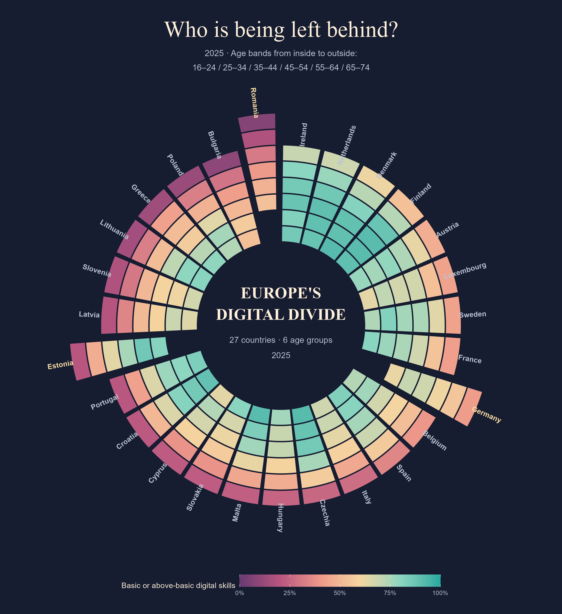

## Our guiding question

How do digital skills differ across age groups in the European Union, and how do Germany, Estonia and Romania compare with the wider European pattern?

We use Eurostat data for 2021, 2023 and 2025, focusing on six age groups between 16 and 74. Our main measure is the percentage of individuals with basic or above-basic overall digital skills. We will also investigate a compatible internet-use indicator to explore how being online differs from having digital skills.

## Data scope

Our source is Eurostat's "Individuals' level of digital skills (from 2021 onwards)" dataset, code `isoc_sk_dskl_i21`.

- Years: 2021, 2023 and 2025.
- Main comparison: Germany, Estonia and Romania, with the EU-27 average as a benchmark.
- Planned wider context: age patterns across EU countries, subject to checking data availability.
- Age groups: 16–24, 25–34, 35–44, 45–54, 55–64 and 65–74.
- Measure: percentage of individuals with basic or above-basic overall digital skills (`I_DSK2_BAB`; unit `PC_IND`).

These are survey-derived group-level estimates, not individual respondent records. The skills indicator is based on reported digital activities rather than a direct skills test. Our selected age range does not cover people aged 75 or older.

The initial extract contains 120 estimates with no missing values. This includes overall population and education groups alongside the age groups for the three selected countries and the EU-27 benchmark; it does not yet include all EU countries.

## Why this matters

As banking, healthcare and public services move online, differences in digital skills can become barriers to everyday participation. Leppiman, Riivits-Arkonsuo and Pohjola (2021) discuss this challenge in Estonia and Finland, highlighting the importance of access, skills, confidence and support.

Their discussion motivates our age-focused comparison, but does not establish the causes of patterns in our Eurostat data. Older adults have diverse experiences and abilities; age alone should not be treated as an explanation for digital exclusion.

Source: Leppiman, A., Riivits-Arkonsuo, I., & Pohjola, A. (2021). Old-Age Digital Exclusion as a Policy Challenge in Estonia and Finland. https://doi.org/10.1007/978-3-030-51406-8_32

## Digital progress—for whom?

Imagine needing to book a medical appointment or manage your banking online. Moving a service onto a screen does not mean everyone is equally equipped to use it. Our story asks whose digital skills are being reflected when we describe a country as digitally advanced.

{width=100%}

### The comparison changes when we look at age

In 2025, Estonia's digital-skills estimate for people aged 25–34 was 86.0%, compared with Germany's 69.8%. Among people aged 65–74, the order reversed: Germany stood at 41.2%, while Estonia stood at 20.3%. Romania's estimate for the older group was 7.3%.

These comparisons raise a more revealing question than simply asking which country leads: who shares in that country's digital progress?

We will investigate how these age patterns compare across the EU and across 2021, 2023 and 2025. The figures describe differences between age groups; they do not show individuals losing skills as they grow older or establish what causes the differences.

*Source: Eurostat, isoc_sk_dskl_i21; indicator I_DSK2_BAB; percentage of individuals. The circular visual shows 162 estimates covering 27 EU countries and six age groups in 2025. Colours represent percentages, not population sizes. These are survey-derived estimates based on reported digital activities, rather than a direct skills test; people aged 75+ are outside this view.*

[Slide-deck of the data story](presentation.qmd)

```{r}
#| label: packages
#| message: false

# These are the packages used in the report
library(tidyverse)
```


*The following is a potential structure of your report.*

*The following headlines are suggestions only.*

## Outline

*What questions will the report address and why?*

*How can data be accessed. Code for loading.*

*Information how data is collected. Who collects data.*

*Be very brief here! Come to the main point fast. If necessary provide and refer to an appendix. You can also use footnotes.^[This is a footnote, which can be used for more information which may distract from coming to the main point fast.]*

Your report shall follow an "inverted pyramid" story format [see @Dykes2019EffectiveDataStorytelling] .

Remove all this text and put your content.^[Using this template is not mandatory.]

:::{.callout-note}
Optional: Publish your Data Story using [Quarto > Publish > GitHub-Pages](https://quarto.org/docs/publishing/github-pages.html).
:::


## Main Insight *Better give a more substantial title!*

This should present your main point visually with one (or more) figures and text which explains and interprets it as part of your data story.  

*In the report code should be there, but folded in.*

```{r}
#| label: fig-mainvisualization
#| fig-cap: "*The figure shows bubble plots in Hans Rosling's style. But this is just a placeholder.*"
#| warning: false # Use this only when you checked that it is OK. It is not a good default for every figure cell.
 
df <- read_csv("data/country_panel_wdi_who.csv", show_col_types = FALSE)

df |>
  filter(year %in% c(1978, 1998, 2018)) |>
  ggplot(aes(
    x = gdp_per_capita_usd,
    y = life_expectancy_years,
    size = total_population,
    color = region
  )) +
  geom_point(alpha = 0.8) +
  scale_x_log10(breaks = c(300, 3000, 30000)) +
  scale_y_continuous(limits = c(40, 87)) +
  scale_size_area(max_size = 15) +
  scale_color_brewer(palette = "Dark2") +
  facet_wrap(~year) +
  labs(x = "GDP per capita (USD)", y = "Life expectancy (years)") +
  theme_minimal() +
  theme(legend.position = "bottom", panel.border = element_rect()) +
  guides(
    size = "none",
    color = guide_legend(ncol = 4, override.aes = list(size = 4), title = NULL)
  )
```

Label your Figures using `label: fig-something`, then you can create cross references like @fig-mainvisualization. It is a standard practice in research articles to refer to Figures in this way. For example: @fig-lifeexpectancy shows the life expectancy for the countries with a population larger than more than 20 million. 

*Refer here to*

- *Additional visualizations and analysis below*
- *Accompnaying Dashboards*
- *...*

## Additional insights

*Better give a more substantial title.*

```{r}
#| label: fig-lifeexpectancy
#| fig-height: 7
#| fig-cap: "*This is just a placeholder.*"

df |>
  filter(year == 2016, total_population > 20000000) |>
  summarize(
    mean_var = mean(life_expectancy_years),
    .by = c(country_name, region)
  ) |>
  arrange(mean_var) |>
  ggplot(aes(
    x = mean_var,
    y = country_name |> fct_inorder(),
    fill = region
  )) +
  geom_col() +
  labs(
    title = "Life Expectancy, Countries with more than 20 Mio.",
    x = "",
    y = "",
    fill = ""
  ) +
  scale_fill_brewer(palette = "Dark2") +
  theme_minimal()
```

### You may have subsections here or elsewhere

### However, subsections usually make sense when there is more than one

## Conclusion

*Topics like: What have we learned? How does it fit in or help in broader contexts? Any actions recommended? What remains open? What are next steps? Which of these questions are most relevant depends on the type of your project.*

## Interactive Visualization / Data Dashboard {.appendix}

*Either have this here or on another webpage (new quarto file).*

*Interactive visualizations may also appear above.* 

*The focus here is to provide the reader with sensible ways to explore the data independently. You have to think about what could be of interest.*


## Data Source {.appendix}

*If specific information and details about the data source would be too long in the "Outline" section, put it in an appendix section.* 

## Other appendix sections {.appendix}

*Do the same with other text which distracts the reading of the main text.*

## References {.unnumbered .appendix}

*This is compiled automatically from all citations. Here, just one reference was cited. It has been cited in the text as `@Dykes2019EffectiveDataStorytelling`, and this cite-key refers to the cite-keys in the Zotero Group <https://www.zotero.org/groups/6686224/visual_communication_and_data_storytelling/library> which the instructor compiled.*

*See more details in the [Bibliography Example](bibliography-example.qmd).* 

---

::: {#refs}
:::
